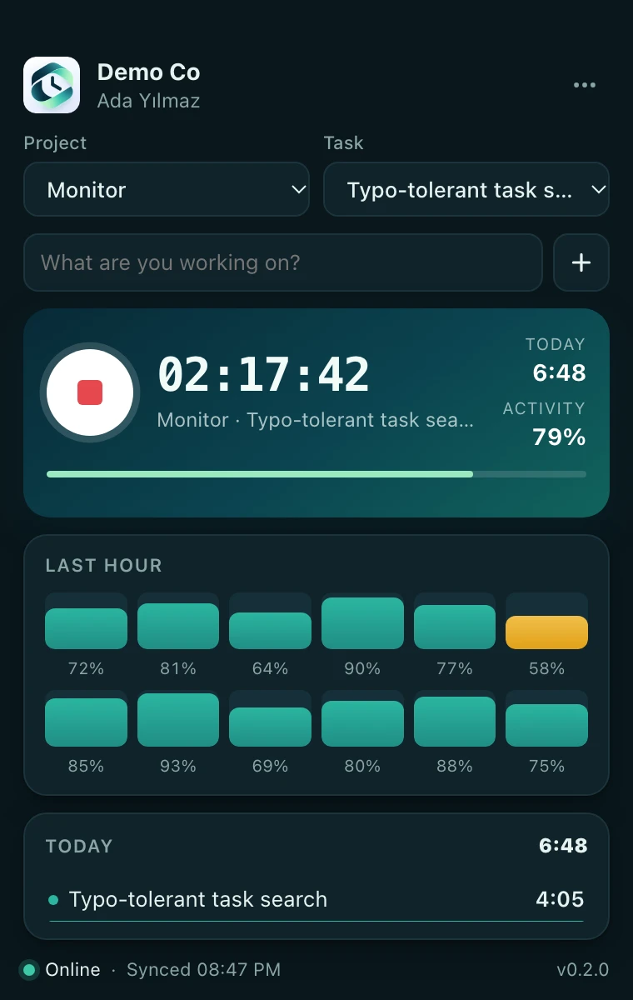

<div align="center">


# Sentroy Monitor

### Time tracking your team can read, and nothing it shouldn't.

Start the timer and the tray app records time and an activity percentage. The web app turns
that into timelines and reports. It never records keystrokes, window titles or what's on a page.

[**Download**](https://github.com/Sentroy-Co/sentroy-monitor-desktop/releases/latest) · [**Open the web app**](https://monitor.sentroy.com) · [**Self-host**](server/README.md) · [**Sentroy**](https://sentroy.com)

<br>

&nbsp;&nbsp;

</div>

---

### Get the app

| | Download | Notes |
|---|---|---|
| **macOS** | [`.dmg`](https://github.com/Sentroy-Co/sentroy-monitor-desktop/releases/latest) | Universal (Apple silicon + Intel), signed and notarized |
| **Windows** | [`.exe` / `.msi`](https://github.com/Sentroy-Co/sentroy-monitor-desktop/releases/latest) | Windows 10 and 11, x64 |
| **Linux** | [`.AppImage` / `.deb`](https://github.com/Sentroy-Co/sentroy-monitor-desktop/releases/latest) | Full tracking on X11; time only on Wayland |

Sign in through your browser with a short code, so your password never goes into the app. Updates
install with one click; the app never restarts on its own while you're tracking.

### What it sees

|  | Recorded | Never recorded |
|---|---|---|
| **Time** | Only while *you* have started the timer | Anything after you stop it |
| **Input** | How many seconds had keyboard or mouse input | Which keys, what you typed, where you clicked |
| **Apps** | The name of the app in front ("Figma") | Window titles, file names, documents |
| **Websites** | Only if your company turns it on: the site name of the tab in front ("github.com"), on macOS | Pages, searches, anything on the page |
| **Screen** | Screenshots, only if your company turns them on: you get a notice every time, and they can be blurred on your computer before upload. With several displays, one screenshot shows all of them side by side | Anything when screenshots are off (the default) |

The agent needs no Accessibility or Input Monitoring permission. Data waits on disk while you're
offline and syncs when you're back. [The full detail →](docs/PRIVACY.md)

### The web app

- **Timeline**: every ten minutes of the day, with activity and the apps in use.
- **Reports**: time by person and day, with CSV export.
- **Settings**: screenshots on or off, how often, blur, idle limit, and how long data is kept.
- Available in English, Türkçe, Русский, 中文, Español and Bahasa Indonesia.

### Run it your way

**Hosted**: sign in at [monitor.sentroy.com](https://monitor.sentroy.com) with your Sentroy account.
It's free; storing screenshots uses your Sentroy Storage plan.

**Self-hosted**: one `docker compose up` gives you your own users, workspaces, SSO (OpenID Connect)
and screenshot storage: Sentroy Storage in one click, any S3-compatible bucket, Firebase Storage or a
local volume. [Set it up →](server/README.md)

<details>
<summary><b>Build from source</b></summary>

<br>

Tauri 2 and Rust, with a plain HTML/JS interface in `ui/`.

```bash
npm install
npm run dev     # run the app
npm test        # Rust tests + UI tests
```

To work against a local server, start it on port 3014 and enter `http://localhost:3014` on the
sign-in screen. Linux needs WebKitGTK, appindicator and the X11/PipeWire headers listed in
`.github/workflows/release.yml`.

Releases and auto-update signing: [docs/RELEASING.md](docs/RELEASING.md).

</details>

<div align="center"><sub>Part of <a href="https://github.com/Sentroy-Co">Sentroy</a> · Fair Source under <a href="LICENSE">FSL-1.1-ALv2</a> · <a href="https://sentroy.com">sentroy.com</a></sub></div>
