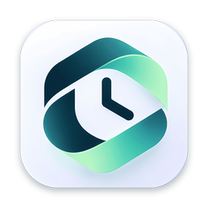
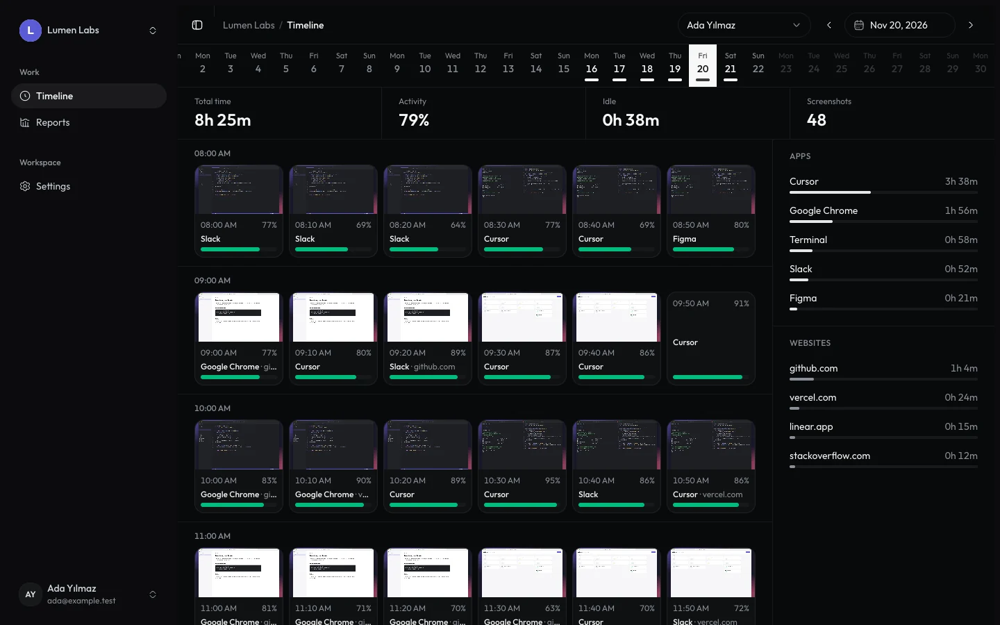
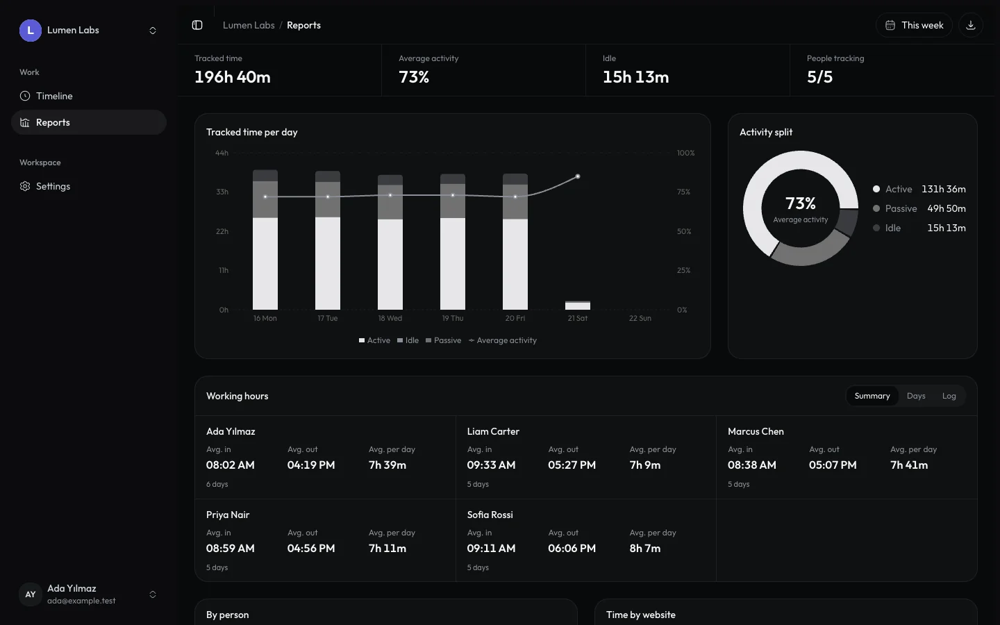
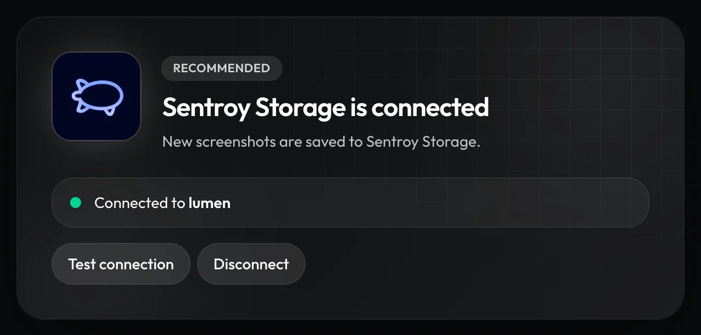
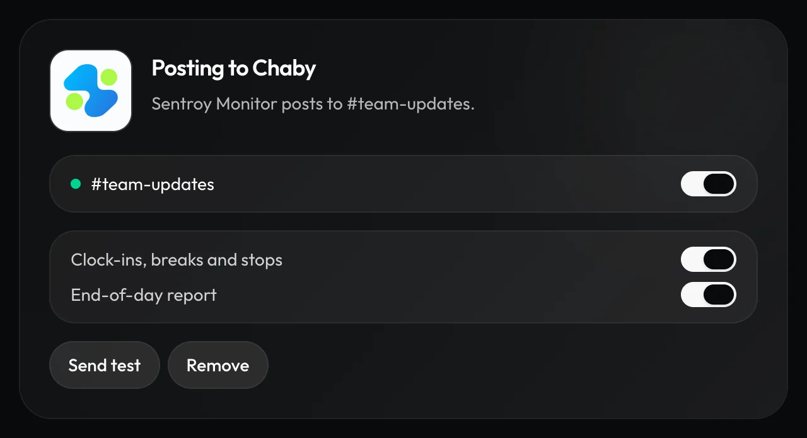

<div align="center">



# Sentroy Monitor

**Open-source time and screen activity tracking for your team.**

See who is working on what, for how long, and how active the day was: in one timeline,
with screenshots and reports, on your own server or ours.

[**Download**](https://github.com/Sentroy-Co/sentroy-monitor-desktop/releases/latest) · [**Open the web app**](https://monitor.sentroy.com) · [**Self-host**](server/README.md)

<br>



</div>

## Features

<table>
<tr>
<td width="62%" valign="top">

**⏱ Time tracking with one button.** Team members start and stop the timer in a small desktop app
for macOS, Windows and Linux. Stepping away or ending the day takes one click, with an optional note.

**📸 Screenshots, done respectfully.** Turn them on per workspace, choose how often, and blur them on
the computer before upload. People get a notice every time. Several displays become one image.

**📊 Timeline and reports.** Every ten minutes of the day with activity, apps and websites.
Weekly charts, time per person, clock-in and clock-out times with averages, and CSV export.

**🖥 Apps and websites.** See which apps were in front and, if you turn it on, which sites (by
domain only). Never keystrokes, window titles or page contents.

**🔒 Private by design.** Tracking runs only while the timer is on. Data waits on the computer
while offline and syncs later. [What is recorded →](docs/PRIVACY.md)

**🌍 Six languages.** English, Türkçe, Русский, 中文, Español and Bahasa Indonesia, in the apps and in
notifications.

</td>
<td width="38%" valign="top" align="center">


</td>
</tr>
</table>



### Works with Sentroy

<table>
<tr>
<td width="50%" valign="top">

&nbsp;**Sentroy Storage**<br clear="left">

Screenshots go to your Sentroy Storage bucket, connected in one click. Prefer your own? Any
S3-compatible bucket, Firebase Storage or a local disk works too.



</td>
<td width="50%" valign="top">

&nbsp;**Chaby**<br clear="left">

Clock-ins, breaks and end-of-day reports are posted to a Chaby channel of your choice, or sent to
any webhook (Slack-compatible, signed).



</td>
</tr>
</table>

## Quick install

**Hosted (easiest).** Sign in at [monitor.sentroy.com](https://monitor.sentroy.com) with your
Sentroy account; your workspace and Sentroy Storage are set up for you. Then everyone installs the
desktop app:

| macOS | Windows | Linux |
|:---:|:---:|:---:|
| [Download `.dmg`](https://github.com/Sentroy-Co/sentroy-monitor-desktop/releases/latest)<br><sub>Apple silicon + Intel</sub> | [Download `.exe`](https://github.com/Sentroy-Co/sentroy-monitor-desktop/releases/latest)<br><sub>Windows 10 and 11</sub> | [`.AppImage` / `.deb`](https://github.com/Sentroy-Co/sentroy-monitor-desktop/releases/latest)<br><sub>X11; time only on Wayland</sub> |

**Self-hosted.** Your own users, workspaces and single sign-on, with MongoDB or PostgreSQL:

```bash
curl -fsSLO https://raw.githubusercontent.com/Sentroy-Co/sentroy-monitor-desktop/main/server/docker-compose.yml
echo "MONITOR_PUBLIC_URL=https://monitor.example.com" > .env
echo "MONITOR_ENCRYPTION_KEY=$(openssl rand -base64 32)" >> .env
docker compose up -d
```

Open `/setup` to create the first administrator. [Full self-host guide →](server/README.md)

## How it works

1. **Sign in.** Open the desktop app, click **Continue with Sentroy** (or enter your server's
   address) and confirm the short code in your browser. Your password never goes into the app.
2. **Start the timer.** The app records time, activity and the apps in front, plus screenshots
   if your workspace turned them on. Stop it for a break or end the day with a note.
3. **Follow the team.** Owners and admins see everyone's timeline, reports and working hours in the
   web app; members see their own.
4. **Set it up your way.** In **Settings**: screenshots and blur, website tracking, idle limit,
   data retention, storage, and Chaby or webhook notifications. App updates install with one click.

<br>

<div align="center">

<a href="https://sentroy.com">
  <picture>
    <source media="(prefers-color-scheme: dark)" srcset=".github/readme/sentroy-logo-dark.svg">
    
  </picture>
</a>

<sub>Sentroy Monitor is built and supported by <a href="https://sentroy.com">Sentroy</a>.<br>
Fair Source under <a href="LICENSE">FSL-1.1-ALv2</a> (becomes Apache 2.0 after two years) · <a href="docs/DEVELOPMENT.md">Development</a> · <a href="docs/PRIVACY.md">Privacy</a></sub>

</div>
